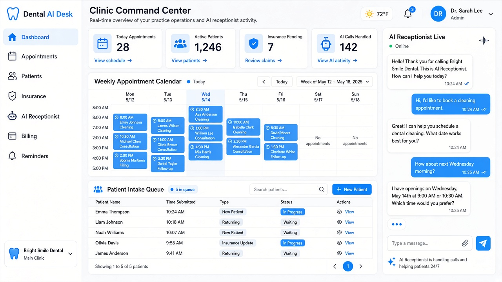

# AI Dental Receptionist / Admin Agent



**SEO description:** AI dental receptionist and admin agent for appointment booking, patient intake, insurance checks, and front-desk automation that saves clinics hours daily.

**Tagline:** AI front desk for modern dental clinics  
**Industry:** Dental / Healthcare  
**Accent:** `#0284C7`  
**Author:** [Imran Ahmed](https://imrandev.bd) (`me@imrandev.bd`)

---

## Why clinics choose this stack

Front-desk teams lose hours every day to ringing phones, incomplete intake forms, insurance “call backs,” and no-show chasing. **AI Dental Receptionist / Admin Agent** is a complete Laravel + Filament business platform that puts an AI receptionist beside your admin ops — booking chairs, verifying eligibility, generating estimates, and queuing reminders — with **every module toggleable**.

### Clinic time-saver ROI

| Manual front-desk work | Typical weekly hours | With Dental AI Desk |
|---|---|---|
| Appointment booking / reschedules | 8–14 hrs | AI + self-serve intents cut ~60% |
| Insurance eligibility calls | 4–8 hrs | Automated checks + benefits summary |
| Intake follow-ups | 3–5 hrs | Digital charts + status tracking |
| Reminder / recall dialing | 3–6 hrs | SMS/email reminder engine |
| Estimate & co-pay confusion | 2–4 hrs | Structured invoices & patient responsibility |

A mid-size practice often recovers **10–20 staff hours per week**. At fully-loaded front-desk cost, that is frequently **$1,500–$4,000+/month** in recovered capacity — before counting fewer no-shows and fuller hygiene schedules.

---

## Features

- **AI Receptionist** — chat/voice/SMS intent handling, transcripts, escalations, AI-booked appointments
- **Appointments** — chair-time board, providers, procedures, sources, reschedule-ready statuses
- **Patients & Intake** — chart numbers, medical alerts, preferred language, intake pipeline
- **Insurance Checks** — policies, eligibility runs, benefits summaries
- **Billing** — estimates, patient responsibility, payments, invoice lifecycle
- **Reminders** — queued SMS/email templates tied to appointments
- **Module Control Plane** — enable/disable domains from config + Filament Modules resource
- **Multi-role users** — Super Admin, Admin, Manager, Staff, Client, Demo
- **Public marketing pages** — home, features, modules, pricing, demo
- **Dockerized** — `Dockerfile`, `docker-compose.yml`, nginx, MySQL, Redis
- **Packagist toolkit** — `imrandevbd/*` packages for AI hub, catalog, PDF, slug, speed, admin, attendance

---

## Modules (on/off)

| Module key | Default | Purpose |
|---|---|---|
| `appointments` | ON | Scheduling & chair board |
| `patients` | ON | Charts & intake |
| `insurance` | ON | Eligibility & benefits |
| `reception_ai` | ON | AI front desk agent |
| `billing` | ON | Estimates & invoices |
| `reminders` | ON | Confirmations & recalls |
| `attendance` | OFF | Optional staff time-clock hub |

Filament navigation hides disabled modules. Services refuse work when their module is off.

---

## Tech stack

- PHP 8.3+ / Laravel 13
- Filament 4 admin (`/admin`) — primary color `#0284C7`
- Livewire 3
- SQLite (local default) or MySQL (Docker)
- Packages:
  - `imrandevbd/drutogoti`
  - `imrandevbd/laravel-admin-panel`
  - `imrandevbd/laravel-ai-catalog`
  - `imrandevbd/laravel-ai-hub`
  - `imrandevbd/laravel-attendance-hub`
  - `imrandevbd/laravel-unicode-pdf`
  - `imrandevbd/laravel-universal-slug`

> **Note:** Upstream Packagist builds of `drutogoti`, `laravel-admin-panel`, and `laravel-attendance-hub` currently constrain `illuminate/*` to Laravel 11/12. This repo vendors Laravel 13–compatible path shims under `packages/` so Composer resolves cleanly while keeping the same package names. Real Packagist installs: `laravel-ai-hub`, `laravel-ai-catalog`, `laravel-unicode-pdf`, `laravel-universal-slug`.

---

## Quick start

```bash
composer install
cp .env.example .env
php artisan key:generate
touch database/database.sqlite
php artisan migrate --seed
php artisan serve
```

- Marketing site: `http://127.0.0.1:8000`
- Filament admin: `http://127.0.0.1:8000/admin`

### Demo users (password: `password`)

| Role | Email |
|---|---|
| Demo | `demo@dental-ai.test` |
| Super Admin | `superadmin@dental-ai.test` |
| Admin | `admin@dental-ai.test` |
| Manager | `manager@dental-ai.test` |
| Staff | `staff@dental-ai.test` |
| Client | `client@dental-ai.test` |

---

## Docker

```bash
docker compose up --build -d
```

Nginx serves on port **8080**, MySQL on **3307**, Redis on **6380**.

---

## Opportunities for DSOs & vendors

- White-label AI receptionist for dental groups
- Payer-directory connectors per region
- Hygiene recall marketplace integrations
- Chair utilization analytics for multi-location operators
- Embedded financing offers at estimate time

---

## Repository map

- `app/Models` — Patient, Appointment, Insurance*, AgentConversation, Invoice, Reminder, ModuleSetting
- `app/Services` — booking, insurance, receptionist AI, billing, reminders, module manager
- `app/Filament/Resources` — Filament CRUD for clinic ops
- `app/Filament/Widgets` — clinic stats + today’s board
- `config/modules.php` — feature flags
- `resources/views/marketing` — public SEO pages
- `docs/screenshots/dashboard.png` — unique clinic dashboard visual

---

## 🤝 Let's Connect & Collaborate

I am open to Senior Remote Full-Stack Roles, AI Platform Architecture Contracts, and Enterprise Technical Advisory.

Timezone: UTC+6 (Dhaka / Rangpur, Bangladesh) — Flexible overlap with US, UK, and European business hours.

Delivery Mode: Async-ready, Slack, Discord, Jira, GitHub, and production-first accountability.

| Channel | Address / Handle | Quick Action |
|---|---|---|
| 🌐 Primary Portfolio | [imrandev.bd](https://imrandev.bd) | [Visit Site ↗](https://imrandev.bd) |
| 📦 Packagist Packages | [packagist.org/packages/imrandevbd/](https://packagist.org/packages/imrandevbd/) | [View Packages ↗](https://packagist.org/packages/imrandevbd/) |
| 💼 LinkedIn Profile | [linkedin.com/in/imranbru99](https://linkedin.com/in/imranbru99) | [Connect ↗](https://linkedin.com/in/imranbru99) |
| 🐙 GitHub Profile | [github.com/imranbru99](https://github.com/imranbru99) | [Follow ↗](https://github.com/imranbru99) |
| 💬 WhatsApp Direct | +880 1576-918420 | [Chat Now ↗](https://wa.me/8801576918420) |
| 📧 Direct Email | me@imrandev.bd | [Send Email ↗](mailto:me@imrandev.bd) |
| 🐦 X (Twitter) | [@imrandev_bd](https://x.com/imrandev_bd) | [Follow ↗](https://x.com/imrandev_bd) |
| 📺 YouTube Tech | [@ImranDevBD](https://youtube.com/@ImranDevBD) | [Subscribe ↗](https://youtube.com/@ImranDevBD) |
